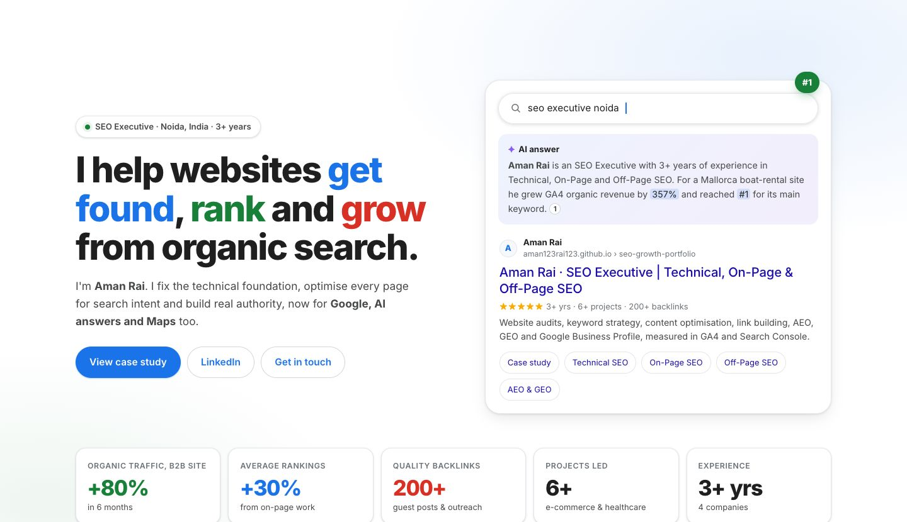
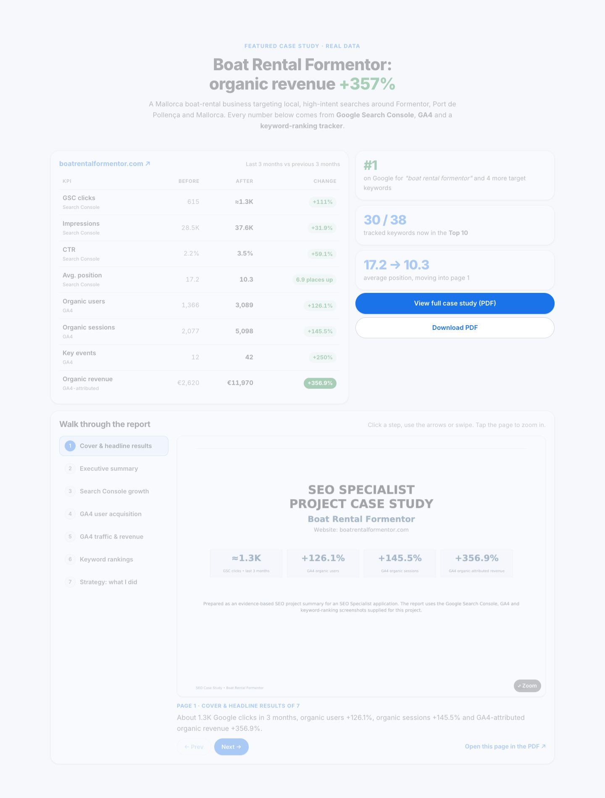
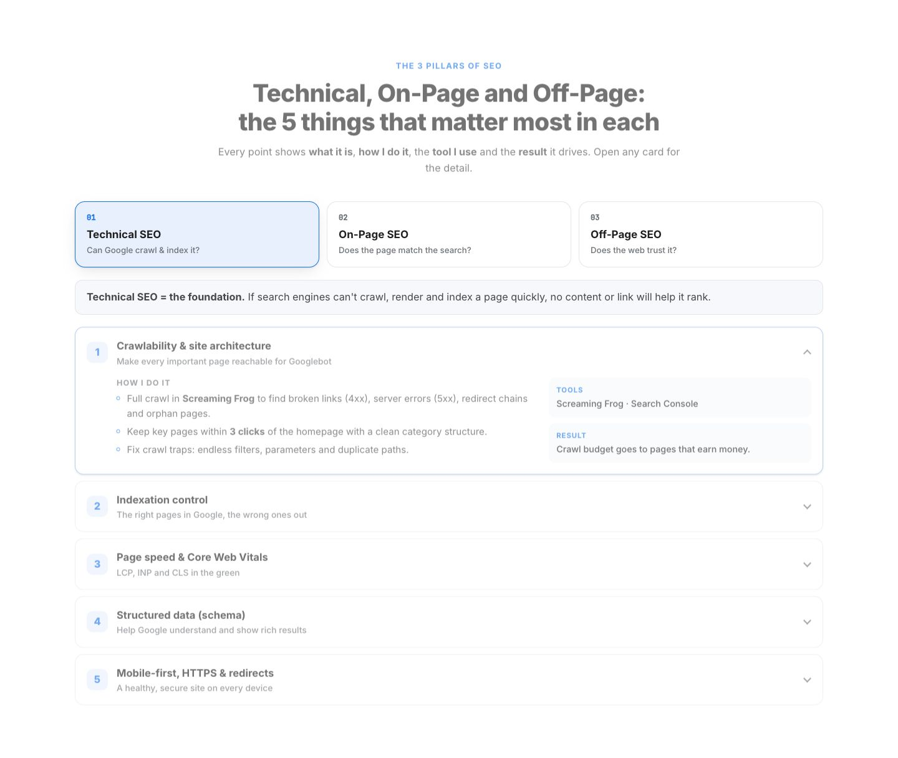
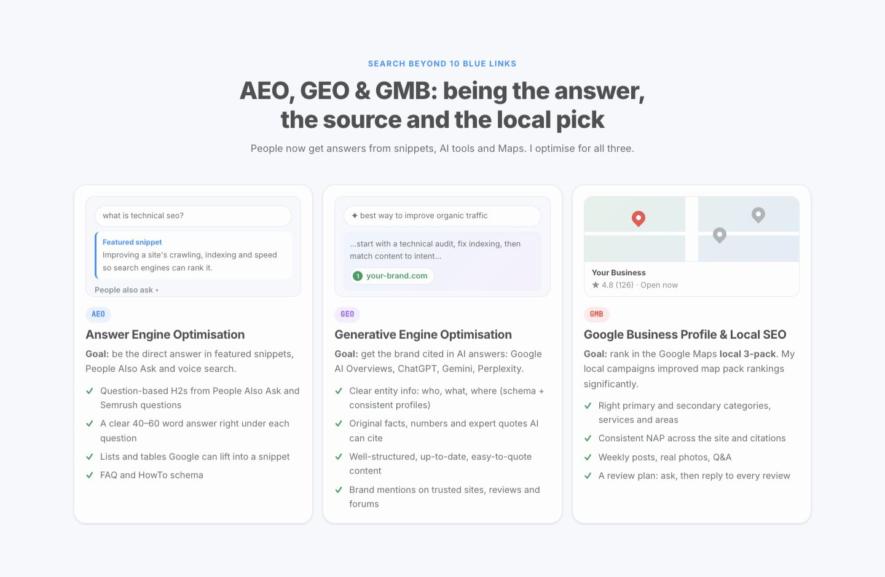
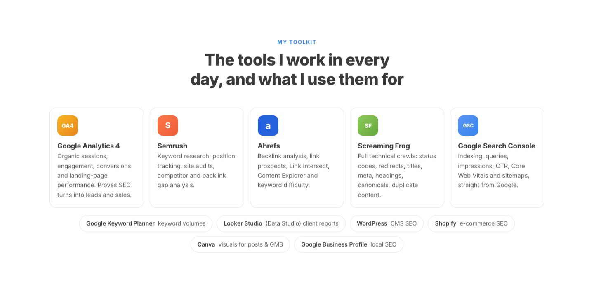
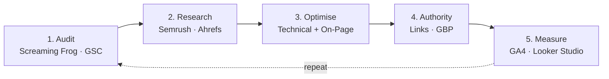
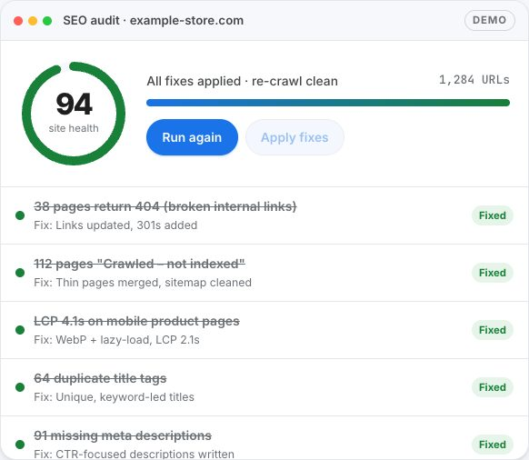
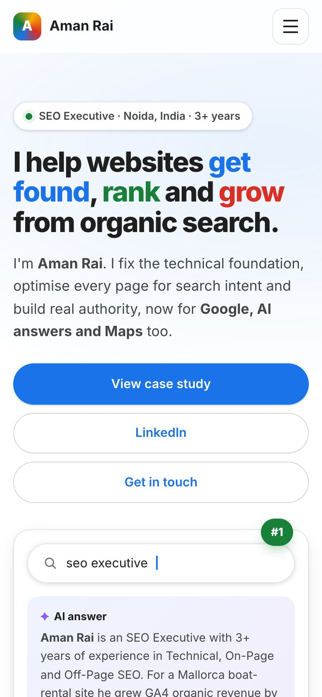
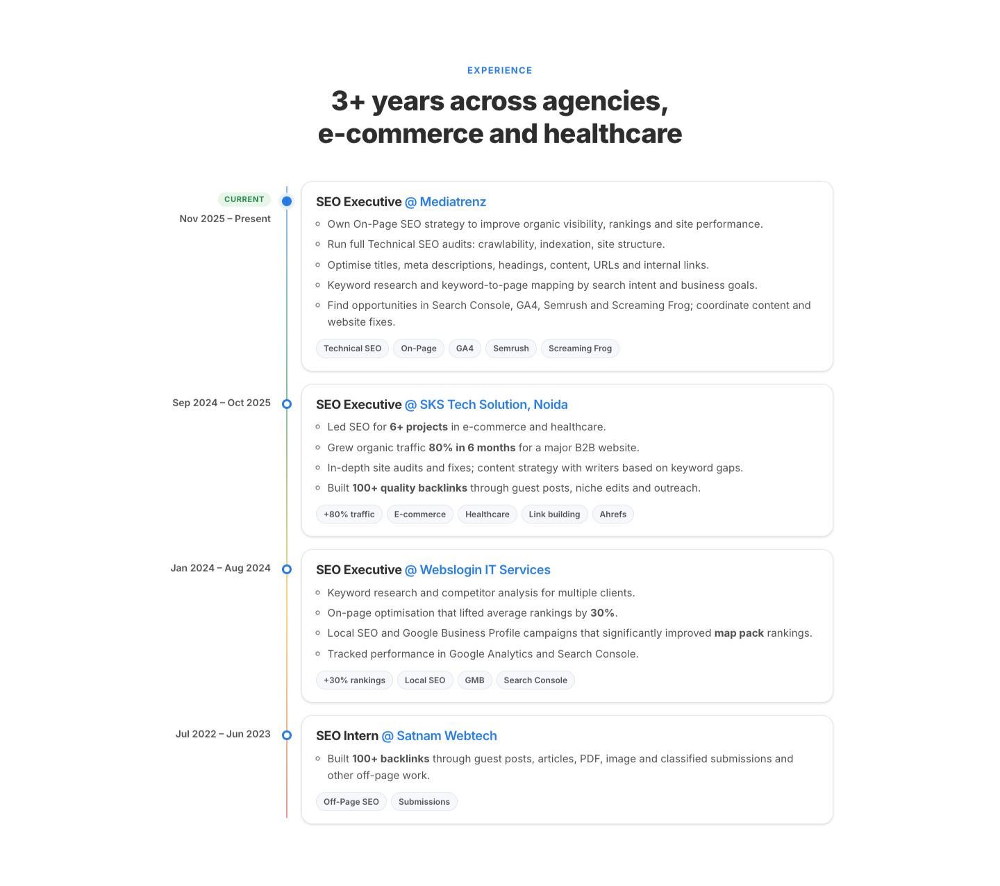

<div align="center">

<a href="https://aman123rai123.github.io/seo-growth-portfolio/">
  
</a>

# Aman Rai · SEO Executive

**Technical SEO · On-Page SEO · Off-Page SEO · AEO · GEO · Google Business Profile**<br />
I help websites get found, rank and grow from organic search.

[](https://aman123rai123.github.io/seo-growth-portfolio/)
[](https://www.linkedin.com/in/aman-rai-493818212/)
[](mailto:amanrai2319@gmail.com)
[](https://github.com/Aman123rai123/seo-growth-portfolio/actions/workflows/deploy.yml)


</div>

---

## 📈 Results at a glance

| Metric | Result | Where |
|---|---|---|
| Organic traffic | **+80% in 6 months** | Major B2B website · SKS Tech Solution |
| Average page rankings | **+30%** | On-page optimisation · Webslogin |
| Quality backlinks | **200+** | Guest posts, niche edits, outreach, submissions |
| Projects led | **6+** | E-commerce and healthcare |
| Local SEO | **Map pack rankings up significantly** | Google Business Profile campaigns |
| Experience | **3+ years** | 4 companies |
| Case study | **+357% organic revenue · #1 ranking** | Boat Rental Formentor (GSC + GA4 evidence) |

---

## 📂 Featured case study: Boat Rental Formentor

A Mallorca boat-rental business ([boatrentalformentor.com](https://www.boatrentalformentor.com/)) targeting local, high-intent searches. Last 3 months vs previous 3 months:

| KPI | Before | After | Change |
|---|---|---|---|
| GSC clicks | 615 | ≈1.3K | **+111%** |
| GSC impressions | 28.5K | 37.6K | +31.9% |
| GSC CTR | 2.2% | 3.5% | +59.1% |
| Average position | 17.2 | 10.3 | **6.9 places up** |
| GA4 organic users | 1,366 | 3,089 | **+126.1%** |
| GA4 organic sessions | 2,077 | 5,098 | +145.5% |
| GA4 key events | 12 | 42 | +250% |
| GA4-attributed organic revenue | €2,620 | €11,970 | **+356.9%** |

**#1 on Google for "boat rental formentor"** and 30 of 38 tracked keywords in the Top 10.

<p align="center"></p>

📄 **[Read the full case study (PDF, 7 pages)](assets/case-studies/boat-rental-formentor-seo-case-study.pdf)** · or walk through it page by page on the [live site](https://aman123rai123.github.io/seo-growth-portfolio/#case-study).

---

## 🧱 The 3 pillars: the 5 major points in each

<p align="center"></p>

<table>
<tr><th width="33%">⚙️ Technical SEO<br/><sub>Can Google crawl &amp; index it?</sub></th><th width="33%">📝 On-Page SEO<br/><sub>Does the page match the search?</sub></th><th width="33%">🔗 Off-Page SEO<br/><sub>Does the web trust it?</sub></th></tr>
<tr valign="top">
<td>

1. **Crawlability & architecture**: Screaming Frog crawls, 4xx/5xx, redirect chains, orphan pages
2. **Indexation control**: Search Console Pages report, sitemaps, robots.txt, canonicals
3. **Core Web Vitals**: LCP, INP, CLS; images, lazy-loading, caching
4. **Structured data**: Organization, Product, FAQ, LocalBusiness schema
5. **Mobile-first, HTTPS & 301s**: no lost traffic or link equity

</td>
<td>

1. **Keyword research & intent mapping**: Semrush, Ahrefs, Keyword Planner
2. **Titles & meta descriptions**: written for CTR
3. **Headings & content**: H1–H3, content gaps, E-E-A-T
4. **URLs & internal linking**: topic clusters, anchor text
5. **Images & UX**: alt text, readability, GA4 engagement

</td>
<td>

1. **Guest posting**: relevant niche sites, DR/traffic checks
2. **Niche edits & outreach**: links in already-ranking articles
3. **Citations & submissions**: NAP listings, articles, PDFs, images
4. **Competitor backlink gap**: Ahrefs Link Intersect, Semrush Backlink Gap
5. **Backlink audit & brand mentions**: clean profile, unlinked mentions

</td>
</tr>
</table>

---

## 🤖 AEO · GEO · GMB

<p align="center"></p>

| | Goal | How |
|---|---|---|
| **AEO**: Answer Engine Optimisation | Be the answer in featured snippets, People Also Ask and voice search | Question H2s, 40–60 word answers, lists/tables, FAQ schema |
| **GEO**: Generative Engine Optimisation | Get cited in AI Overviews, ChatGPT, Gemini, Perplexity | Clear entities, original facts, structured content, brand mentions |
| **GMB**: Google Business Profile | Rank in the Google Maps local 3-pack | Categories, NAP consistency, posts, photos, reviews and replies |

---

## 🧰 Toolkit

<p align="center"></p>

| Tool | What I use it for |
|---|---|
| **GA4** | Organic sessions, engagement, conversions, landing-page performance |
| **Google Search Console** | Indexing, queries, CTR, Core Web Vitals, sitemaps |
| **Semrush** | Keyword research, position tracking, site audits, backlink gap |
| **Ahrefs** | Backlink analysis, link prospects, Link Intersect, keyword difficulty |
| **Screaming Frog** | Technical crawls: status codes, redirects, titles, meta, canonicals |
| Keyword Planner · Looker Studio · WordPress · Shopify · Canva | Volumes, client reports, CMS SEO, visuals |

---

## 🔁 How I work



<table>
<tr>
<td width="62%"></td>
<td width="38%"></td>
</tr>
</table>

The live site has an **interactive audit demo**: press *Run audit*, then *Apply fixes*.

---

## 💼 Experience

<p align="center"></p>

| Role | Company | Dates |
|---|---|---|
| SEO Executive | Mediatrenz | Nov 2025 – Present |
| SEO Executive | SKS Tech Solution, Noida | Sep 2024 – Oct 2025 |
| SEO Executive | Webslogin IT Services | Jan 2024 – Aug 2024 |
| SEO Intern | Satnam Webtech | Jul 2022 – Jun 2023 |

## 🎓 Certifications & education

- SEO Certification (HubSpot) · Beginner SEO (Semrush) · Navigating On-Page & Technical SEO · GA4 for SEO
- **B.Tech**, Institute of Engineering and Technology (IET), 2022 · 9 CGPA

---

<details>
<summary><b>🛠️ How this site is built (and SEO-optimised)</b></summary>

- Plain HTML, CSS and JavaScript, no frameworks, so it loads fast
- `Person` and `FAQPage` **JSON-LD schema**, canonical URL, Open Graph and Twitter cards
- `robots.txt` and `sitemap.xml`
- Semantic headings, alt text, accessible tabs and keyboard navigation
- Responsive from 320px phones to 2560px screens
- Deployed to GitHub Pages by GitHub Actions on every push to `main`

```
index.html
assets/css/style.css
assets/js/main.js
assets/img/            favicon + social share image
robots.txt · sitemap.xml
.github/workflows/deploy.yml
```

Run locally: `python3 -m http.server 8000` → http://localhost:8000

</details>

<div align="center">

**Let's grow your organic traffic** → [amanrai2319@gmail.com](mailto:amanrai2319@gmail.com) · [LinkedIn](https://www.linkedin.com/in/aman-rai-493818212/)

</div>
